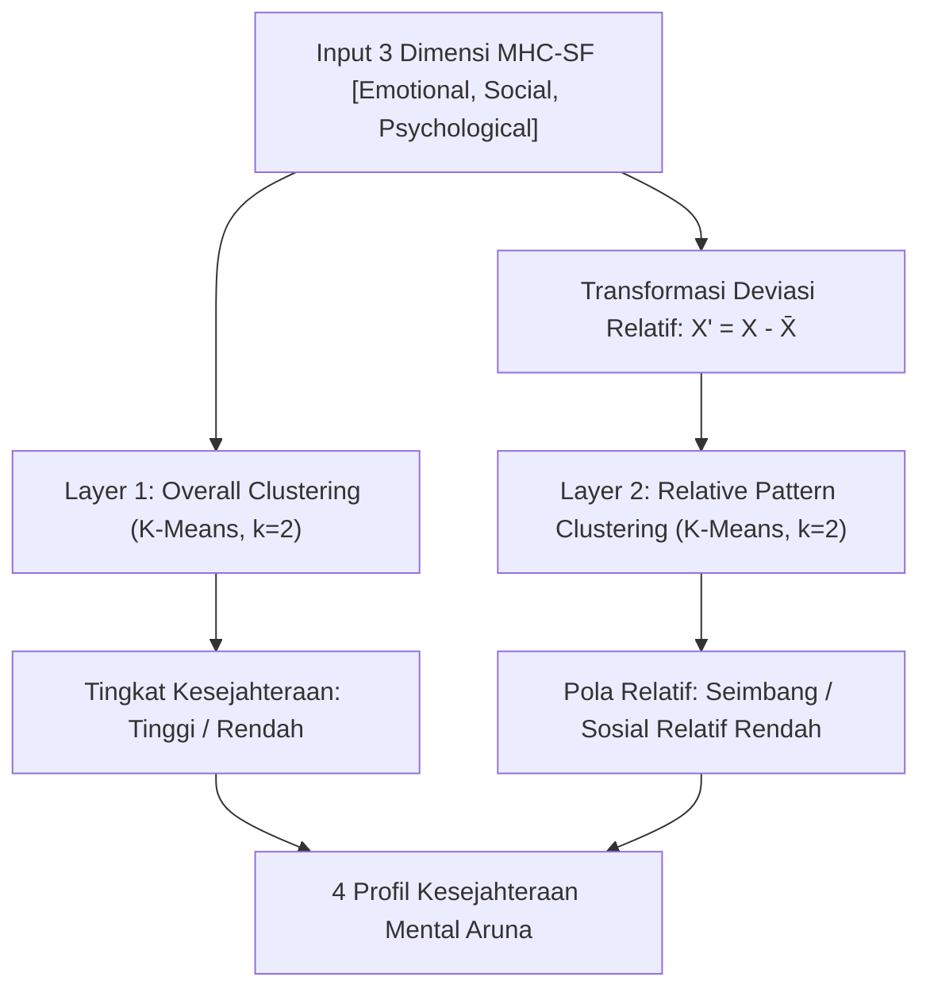

# 🌱 ARUNA: Pemetaan Profil Kesejahteraan Mental Mahasiswa

> **Master Project PBL Pembelajaran Mesin (TEK1302) · Kelompok 2**  
> *Mapping Student Mental Well-Being Profiles Based on Emotional, Social, and Psychological Dimensions Using Unsupervised Machine Learning.*

---

## 📌 1. Pendahuluan & Tujuan Penelitian

Aruna merupakan sistem pemetaan profil kesejahteraan mental mahasiswa berbasis **Unsupervised Machine Learning** yang diimplementasikan ke dalam aplikasi web interaktif berbasis Python dan Streamlit.

### Latar Belakang Masalah
Kesejahteraan mental merupakan kondisi multidimensional yang tidak cukup dijelaskan hanya melalui satu skor keseluruhan. Dua individu dapat memiliki skor total yang identik, namun memiliki kombinasi dimensi yang sangat berbeda (misalnya, emosional tinggi tetapi dimensi sosial relatif rendah). 

Aruna hadir untuk mengeksplorasi kombinasi tingkat kesejahteraan dan pola relatif antardimensi tanpa menentukan label kategori sejak awal (*unsupervised pattern discovery*).

### Instrumen Pengukuran: MHC-SF
Menggunakan instrumen *Mental Health Continuum-Short Form* (Keyes, 2002) yang terdiri atas 14 butir pertanyaan:
1. **Emotional Well-Being (3 butir):** Kebahagiaan, ketertarikan, dan kepuasan hidup.
2. **Social Well-Being (5 butir):** Kontribusi sosial, keterhubungan komunitas, integrasi, penerimaan, dan pemahaman sosial.
3. **Psychological Well-Being (6 butir):** Penerimaan diri, relasi positif, otonomi, penguasaan lingkungan, pertumbuhan pribadi, dan tujuan hidup.

---

## 🧠 2. Arsitektur Machine Learning: Two-Layer Clustering

Aruna menggunakan pendekatan **Two-Layer K-Means Clustering**:



### 4 Profil Aruna
1. **Tinggi - Seimbang (19.88%):** Kesejahteraan umum tinggi dengan dimensi seimbang.
2. **Tinggi - Sosial Relatif Rendah (29.22%):** Kesejahteraan umum tinggi, namun dimensi sosial relatif rendah.
3. **Rendah - Seimbang (27.71%):** Kesejahteraan umum rendah secara menyeluruh.
4. **Rendah - Sosial Relatif Rendah (23.19%):** Kesejahteraan umum rendah dengan aspek sosial sebagai dimensi paling rentan.

---

## 📂 3. Struktur Direktori Proyek

```text
ARUNA/
├── data/
│   ├── reference/             # Dataset referensi penelitian (thesis data set.xlsx)
│   └── uploaded/              # Dataset baru yang diunggah administrator
├── database/
│   └── aruna.db               # Database SQLite lokal untuk riwayat asesmen
├── models/
│   ├── active/                # Model final aktif (aruna_model_final.joblib)
│   ├── versions/              # Arsip versi model (aruna_model_v1.0.joblib)
│   └── registry.json          # Metadata versi model
├── notebooks/
│   ├── 00_Aruna_Notebook_Audit Data.ipynb
│   ├── 01_Aruna_Notebook_Proto.ipynb
│   └── 02_Aruna_Notebook_Final.ipynb  # SINGLE SOURCE OF TRUTH (75 cells)
├── src/
│   ├── __init__.py
│   ├── preprocessing.py       # Validasi, encoding 0-5, agregasi fitur B_3 & A_14
│   ├── clustering.py          # Implementasi K-Means, K-Medoids, Agglomerative, Two-Layer
│   ├── evaluation.py          # Metrik evaluasi internal, stabilitas ARI, holdout
│   ├── prediction.py          # Inferensi model aktif menggunakan joblib
│   ├── pipeline.py            # Rantai asesmen end-to-end
│   ├── recommendations.py     # Mesin rekomendasi hybrid
│   ├── model_registry.py      # Pengelolaan metadata versi model
│   ├── database.py            # SQLite helper
│   ├── mhcsf_config.py        # Konfigurasi butir MHC-SF bahasa Indonesia
│   └── theme.py               # Tema simplistic modern & ilustrasi vektor organik
├── pages/
│   ├── 0_Home.py              # Landing page pemisah Mahasiswa & Admin
│   ├── 1_Admin_Dashboard.py   # Dashboard ringkasan eksekutif
│   ├── 2_Dataset_Management.py# Upload dan validasi dataset
│   ├── 3_Model_Training.py    # Pelatihan ulang model Two-Layer
│   ├── 4_Model_Evaluation.py  # Evaluasi & perbandingan model
│   ├── 5_Model_Registry.py    # Manajemen versi model
│   ├── 6_Student_Assessment.py# Kuesioner MHC-SF & hasil pemetaan mahasiswa
│   └── 7_Student_History.py   # Riwayat asesmen mahasiswa
├── test/
│   ├── test_clustering.py     # Pengujian langsung modul clustering
│   ├── test_pipeline.py       # Verifikasi end-to-end pipeline
│   └── test_preprocessing.py  # Verifikasi preprocessing dataset
├── app.py                     # Entry point aplikasi Streamlit (st.navigation)
├── requirements.txt           # Kebutuhan library Python
└── README.md                  # Dokumentasi teknis proyek
```

---

## 🚀 4. Instalasi & Menjalankan Aplikasi

### Persyaratan Sistem
* Python 3.10+ (disarankan environment Conda/venv)
* Git

### Langkah Menjalankan
1. **Clone atau buka repositori:**
   ```powershell
   cd "D:\Pembelajaran Mesin\ARUNA"
   ```

2. **Install dependency:**
   ```powershell
   pip install -r requirements.txt
   ```

3. **Jalankan aplikasi Streamlit:**
   ```powershell
   streamlit run app.py
   ```
   Aplikasi akan terbuka otomatis di browser pada alamat `http://localhost:8501`.

4. **Menjalankan pengujian langsung:**
   ```powershell
   python test/test_pipeline.py
   python test/test_clustering.py
   ```

---

## ⚖️ 5. Batasan & Etika Penelitian

1. **Bukan Alat Diagnosis:** Aruna adalah sistem pemetaan profil kesejahteraan mental berbasis survei (*self-reflection*). Hasilnya bukan diagnosis medis/psikiatri dan tidak menggantikan konsultasi profesional dengan psikolog atau konselor.
2. **Keterbatasan Dataset:** Model dilatih menggunakan dataset sekunder mahasiswa sarjana di Kanada ($N=332$ responden lengkap). Pola ini memerlukan validasi eksternal lebih lanjut jika ingin digeneralisasi ke populasi mahasiswa Indonesia.
3. **Privasi & Kerahasiaan:** Data respons kuesioner disimpan secara lokal tanpa mengaitkan data identitas pribadi mahasiswa secara langsung (*anonymized*).
